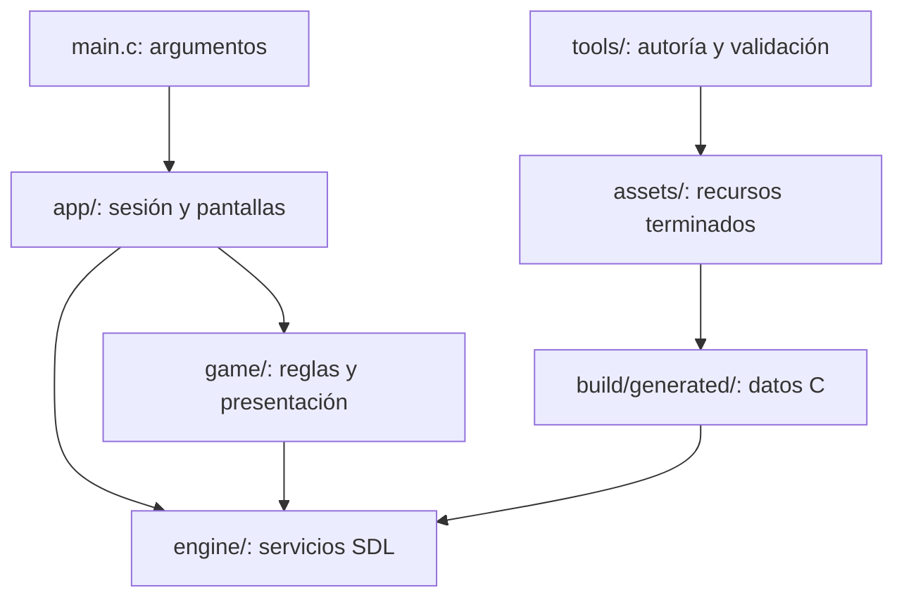

# Arquitectura

El ejecutable usa C11 y SDL2, SDL2_ttf y SDL2_mixer. El motor adapta esos
servicios, las reglas del juego mantienen sus estados y la aplicación los
coordina. Los recursos se incrustan al compilar. El juego terminado no
necesita las herramientas de autoría ni sus grabaciones originales.



## Límites

| Capa | Responsabilidad | Restricción |
| --- | --- | --- |
| `src/main.c` | Argumentos, ayuda y selección de modo | Incluye interfaces de `app/`; SDL solo adapta la entrada de Windows |
| `src/app/` | Sesión, actualización fija, pantallas, opciones, capturas y verificación | Coordina servicios y reglas; no se incluye desde `game/` o `engine/` |
| `src/game/` | Estados, combate, terreno, progreso y dibujo del juego | No depende de `app/`; los archivos de reglas de `CORE_SRC` tampoco dependen de SDL, ni indirectamente |
| `src/engine/` | Entrada, animación, ventana, audio, recursos, texto y preferencias | No incluye `game/` ni `app/` |
| `tests/` | Reglas e integración con SDL dummy | Incluye cabeceras y enlaza módulos normales; no incluye implementaciones `.c` |
| `tools/` | Generar y validar recursos, limpiar temporales | No participa en el ciclo de ejecución del juego |

`config.h` contiene los parámetros compartidos. `Makefile` declara todos los
archivos C de producción en `CORE_SRC` y `APP_SRC`. Las reglas puras se
compilan sin los flags de SDL ni dependencia de los recursos incrustados.
Los renderizadores de `game/` sí pertenecen al grupo de objetos con SDL.

## Aplicación

`application.c` inicializa y libera los servicios, mantiene la pantalla
actual y ejecuta la simulación a 60 Hz. `StagePlay` y `Profile` viven en
`state.h`; las opciones son un `AppOptions` explícito por instancia, sin
variables globales compartidas para el menú de volumen o la ventana.

`stage.c` aplica una entrada, llama a las reglas de `game/` y consume sus
eventos para audio, partículas y HUD. `stage_render.c` dibuja una vista
interpolada entre dos pasos; no sustituye el estado de la simulación por el
interpolado. Mantiene las copias visuales del jugador y de los zombis.

`options.c` conecta los ajustes puros de `game/settings.c` con ventana,
preferencias y audio. `navigation.c` maneja los sonidos de las transiciones
del almanaque y del Expediente. `verify.c`, `smoke.c` y `capture.c` contienen las herramientas
de diagnóstico, separadas de la entrada y de la partida normal.

La intro declara su secuencia sonora en `game/intro.c`; la aplicación reproduce
sus comandos de efecto, bucle, parada y música. `app/story_audio.c` acompaña el
reloj y los cambios de toma de `Story`, con eventos propios de las cuatro cintas.
Los renderizadores de cinemáticas no reproducen sonidos. Los saltos de tiempo de
Enter no disparan acciones omitidas, y salir limpia las colas y bucles del relato.
Las pruebas de intro y `tests/story_audio.c` verifican esta secuencia sin abrir
ventanas ni reproducir audio real.

`game/mission.c` calcula las metas según recorrido, combate y obstáculos,
lleva el reloj de simulación y liquida estrellas y bonos una sola vez.
`StageRecord` conserva las mejores estrellas y tiempo por misión; `Profile`
conserva también agua y dinamita. `stage_start_profile` transfiere ese inventario
al entrar, y el abandono o reintento restaura el saldo de entrada junto con XP y oro.

`autosave.c` cuenta 900 segundos activos y solicita instantáneas en los hitos
y al salir. `savegame.c` serializa campos explícitos, índices y referencias
reconstruibles, sin punteros ni padding nativo. Valida primero una copia candidata;
solo publica el estado si la instantánea completa es válida. Al continuar regenera
el paisaje y los efectos decorativos, y restaura el estado físico de la misión.

`engine/storage.c` recibe bytes y escribe en un único hilo SDL. Alterna dos
archivos con generación y CRC; publica el temporal completo sobre la copia
inactiva y conserva la última copia aceptada si falla la escritura. Solo espera
al trabajador al cerrar la aplicación. El motor desconoce perfiles, misiones y
versiones del formato del juego. [PROGRESS.md](PROGRESS.md) detalla el contrato.

Las pruebas de audio enlazan esos mismos módulos y sustituyen únicamente la
frontera `engine/audio.h` para registrar qué se reproduce. Así comprueban la
misma implementación que ejecuta el juego, sin compilar una copia de `main.c`.

## Comprobaciones

```sh
make check-architecture
make test
./build.sh
```

`tools/check_architecture.py` detecta archivos C ausentes o duplicados en el
Makefile, dependencias entre capas en dirección incorrecta, SDL transitivo en
la lógica pura y pruebas que incluyen archivos `.c`. Se ejecuta también en
`make test` y `build.sh`. No certifica por sí solo rendimiento, ausencia de
errores de juego o calidad visual: esas propiedades tienen sus pruebas
específicas y requieren además comprobación interactiva.

`tests/persistence_process.py` abre procesos independientes en directorios
temporales con Unicode para probar continuidad, copia truncada, versión
desconocida, escritura fallida y migración de esquema. `tests/persistence.c`
comprueba estado de combate, referencias reconstruidas y los 15 minutos sin
esperar tiempo real. Los modos de capturas y humo desactivan la persistencia.

## Archivos que se conservan y limpieza

`assets/` son recursos terminados; `docs/templates/` y los generadores son
fuentes de autoría; `recordings/` conserva las fuentes de audio verificadas
por hash y sus licencias. No son temporales. `.vscode/` contiene la
configuración de Linux y Windows que usa el proyecto.

`build/`, incluidos previsualizaciones, objetos, pruebas y compilaciones de
depuración, se puede regenerar. `dist/` contiene el juego entregado.

```sh
python3 tools/clean_project.py --dry-run
make tidy
```

La limpieza retira `build/`, cachés Python y archivos de metadatos del sistema;
conserva `dist/`, código, documentación, recursos y fuentes de autoría. La demo
histórica en Python y las instrucciones ajenas de Postman se retiraron del
árbol activo tras guardar una copia fuera del proyecto.

La compatibilidad de código y herramientas contempla Linux y Windows/MSYS2
UCRT64. Una compilación probada en Linux no equivale a una validación nativa
en Windows.
