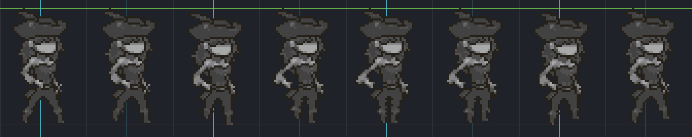
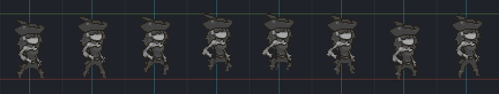
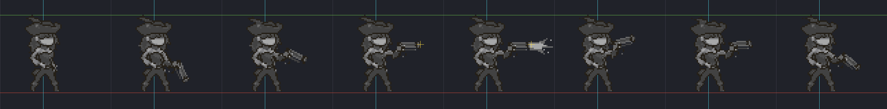

# Personajes

Los personajes jugables, la plantilla que comparten y cómo dibujar uno nuevo con el mismo
estilo. Siguen las reglas de [`SPRITES.md`](SPRITES.md) (PNG RGBA de 8 bits, a 1×, una fila
de cuadros, mirando a la derecha) y el estilo de la vaquera descrito en
[`ZOMBIE.md`](ZOMBIE.md#estilo-de-la-vaquera).

| Personaje | Habilidad | Armas | Arte |
| --- | --- | --- | --- |
| **La Vaquera** (`cowgirl`) | **Botín:** los zombis que vence sueltan cofres | Cañón de mano | Hecho |
| **El SWAT** (`swat`) | **Arsenal:** lleva dos armas y las cambia | Rifle y escopeta | Provisional |
| **El Héroe** (`hero`) | **Prototipo:** arma experimental que atraviesa la armadura | Cañón de plasma | Provisional |

**Provisional** quiere decir que el juego usa a la vaquera teñida de un color (gris azulado
el SWAT, verde azulado el héroe) mientras no existan sus hojas. Se pueden jugar y probar sus
habilidades desde ya; cuando lleguen sus PNG, el juego los usa solo, sin tocar código.

## En el juego

Al abrir el juego aparece **Elige tu personaje** (←/→ y Enter); luego el menú de niveles de
ese personaje. **Cada personaje tiene su propio nivel, experiencia y niveles completados.**
`Esc` regresa: del nivel al menú, del menú a la selección, y de ahí sale del juego.

Los tres comparten controles, cuerpo, vida, armadura y reglas de nivel (ver el
[README](../README.md#niveles-cofres-y-experiencia)). Lo que cambia es su habilidad y sus armas.

### Habilidades

- **Botín (Vaquera):** todos los zombis que vence pueden dejar un cofre (según el nivel, hoy
  uno por zombi). **Sin esta habilidad, solo el último zombi de la misión deja cofre.** Es la
  que más experiencia gana, y la campaña está equilibrada con ella
  (`tests/test_progression.c`).
- **Arsenal (SWAT):** `Q` o clic derecho cambia entre rifle y escopeta, cuando no está a
  mitad de un disparo. El arma en mano se ve abajo a la derecha.
- **Prototipo (Héroe):** su cañón de plasma solo cuenta el 40 % de la armadura del blanco.
  Rinde más cuanto más blindado esté el enemigo.

### Armas

Tabla en `src/game/weapons.c`. El daño es un múltiplo del daño de su nivel de arma, así que
todas crecen igual con el personaje. Están equilibradas a un daño por segundo parecido contra
el zombi antidisturbios, cada una a su manera (`tests/test_characters.c` falla si alguna se
aleja más de 20 % del cañón de mano).

| Arma | Daño por bala | Recarga | Balas por disparo | Alcance | Armadura que cuenta | Color de la bala |
| --- | --- | --- | --- | --- | --- | --- |
| Cañón de mano | ×1.0 | 0.38 s | 1 | Pantalla | 100 % | Original |
| Rifle | ×0.45 | 0.14 s | 1 | Pantalla | 100 % | Blanco azulado |
| Escopeta | ×0.55 | 0.62 s | 3 (separadas 14 px) | 380 px | 100 % | Naranja claro |
| Cañón de plasma | ×1.1 | 0.62 s | 1 | Pantalla | **40 %** | Verde azulado |

Todas usan la misma bala (`sprites/weapons/bullet.png`) teñida con su color.

## La plantilla: lo que todo personaje comparte

Cada personaje se dibuja **sobre las mismas hojas, cuadros, poses y medidas que la vaquera**.
Así el código (animación, pivotes, salto, disparo, colisiones, placa de nivel, salida de la
bala) es el mismo para todos, y un personaje nuevo solo es arte. La vaquera define la
plantilla; estas medidas no cambian.

| Hoja | Tamaño | Cuadro | Cuadros | Qué hace cada cuadro | Pivote (`anchor_x`, `ground_y`) |
| --- | --- | --- | --- | --- | --- |
| `walk.png` | **336 × 67** | 42 × 67 | 8, en ciclo (12 fps, 15 corriendo) | Ciclo de caminata; el cuadro 0 es también la pose de pie | 19.5, 61 |
| `jump.png` | **432 × 82** | 54 × 82 | 8 | 0–5 siguen el arco del salto, 6–7 aterrizaje | 25.5, 69 |
| `shoot.png` | **648 × 80** | 81 × 80 | 8, a 16 fps | 0–2 desenfunda, 3 apunta, **4 dispara**, 5–6 retroceso (se sostiene durante la recarga), 7 enfunda | 31.5, 68 |

| Medida | Valor | Por qué no cambia |
| --- | --- | --- |
| Alto del cuerpo | **56 px**, de la suela a lo más alto de la cabeza o el casco | Escala del juego y de los zombis |
| Suela | 2 filas arriba del `ground_y` de cada hoja (fila 59 en walk, 67 en jump, 66 en shoot) | Pisa la línea del suelo |
| Lo más alto de la cabeza | **57 filas arriba de `ground_y`** (±2) | Ahí cuelga la placa de nivel y salen los avisos de XP |
| Centro del cuerpo | En el pivote: x 19.5 (walk), 25.5 (jump), 31.5 (shoot) | Si se corre, el personaje "baila" al cambiar de animación o al voltear |
| Ancho | 24–29 px en lo más ancho, afinándose hacia los pies (8–13) | Silueta del estilo y caja de golpe |
| **Boca del cañón** | **x 64, y 32.5** en los cuadros 3 y 4 de `shoot.png` | De ahí sale la bala de cualquier arma |
| Fogonazo | Cuadro 4, de x 64 hacia adelante, como mucho hasta x 80 | Cabe en el cuadro |





Líneas: **rojo** el suelo (`ground_y`), **verde** lo más alto de la cabeza, **cian** el
pivote y, en `shoot`, la **cruz amarilla** es la boca del cañón.

## La base (el maniquí)

`docs/templates/character_base/` tiene las tres hojas de la vaquera **en grises neutros**:
sus poses y su sombreado, sin sus colores. Es el punto de partida para cualquier personaje.

1. Copia las tres hojas a `assets/sprites/characters/<id>/` (con el mismo nombre).
2. Pinta encima al personaje, cuadro por cuadro: ropa, cabeza, equipo y arma. El cuerpo, las
   piernas y los brazos ya están en su lugar en cada cuadro.
3. Lo que es de la vaquera y no del personaje (**el sombrero, el pelo, la pluma**) se borra o
   se reemplaza. Lo más alto de la cabeza nueva debe quedar en la línea verde de las guías.
4. El arma se dibuja en la mano como el revólver, con la boca en la cruz amarilla.

Si cambian las hojas de la vaquera, `python3 tools/make_character_base.py` regenera la base y
las guías.

## Estilo

Lo mismo que hace funcionar a la vaquera y al zombi
([`ZOMBIE.md`](ZOMBIE.md#estilo-de-la-vaquera) tiene las medidas):

- **Contorno oscuro `#252018` casi completo**, solo roto donde la luz pega fuerte. Es lo que
  separa a los personajes del paisaje (los fondos van sin contorno).
- **Rampas cálidas y saturadas** para tela, piel y cuero; **los grises neutros del revólver**
  (`#2c2c2c` `#424242` `#505050` `#868689` `#a7a8a8`) para el metal.
- **Fríos solo muy oscuros y algo cálidos**, en áreas pequeñas.
- Cara plana, sin rasgos dibujados. Brillos en trazos cortos sobre el metal.
- **13–16 colores**, 11–17 % de píxeles sueltos, 65–90 % de tonos oscuros, 8–20 % de acentos
  claros (`python3 tools/sprite_style.py <hoja> <ancho de cuadro>` lo mide).
- Diseños propios: nada de logos, insignias, textos ni parecidos con personajes existentes.

## El SWAT

**Concepto:** un policía de unidad táctica en el viejo oeste invadido. Pesado y práctico.

- **Cabeza:** casco táctico redondo y bajo (no más alto que la línea verde) con gafas de
  protección subidas o una visera corta; la cara plana como la de la vaquera, con barba de
  1–2 tonos.
- **Torso:** chaleco antibalas con 2–3 bolsas de 2–3 px, hombreras pequeñas. Lo más ancho son
  los hombros (26–28 px).
- **Piernas:** pantalón táctico con rodilleras de 1 placa, botas altas.
- **Armas:** en `shoot.png` dibuja **el rifle** (corto, de culata plegable), sostenido con las
  dos manos y la boca del cañón en la cruz amarilla. Una sola hoja para las dos armas: la
  escopeta se distingue por sus balas, no por el dibujo.
- **Fogonazo** (cuadro 4): blanco y amarillo, más corto y seco que el del revólver.

| Parte | Colores |
| --- | --- |
| Contorno | `#252018` |
| Uniforme (casi negro cálido): sombra, base, luz | `#1f1d1c` `#2e2b29` `#45403b` |
| Chaleco y bolsas (café oliva): sombra, base, luz | `#3a3524` `#55502f` `#736b41` |
| Casco, rifle y placas: los grises del revólver | `#2c2c2c` `#424242` `#505050` `#868689` |
| Brillos del metal | `#a7a8a8` |
| Piel: sombra, base, luz | `#89411f` `#d99a5b` `#fedca3` |
| Gafas | `#2b3550` con brillo de 1 px `#a7a8a8` |

## El Héroe

**Concepto:** un inventor aventurero que construyó su propia arma para acabar con la plaga.
Ágil, de abrigo largo, con un aparato experimental que brilla.

- **Cabeza:** pelo corto o despeinado y unas gafas de inventor sobre la frente (2–3 px, con
  brillo). Nada de sombrero (eso es de la vaquera).
- **Torso:** abrigo largo hasta las rodillas, abierto, que ondea en la caminata; correas
  cruzadas con un tanque pequeño de energía a la espalda (3–4 px que asoman).
- **Piernas:** pantalón de trabajo, botas.
- **Arma:** **el cañón de plasma**, un aparato de bronce y cobre más grueso que el revólver,
  con bobinas y una cámara que brilla. Se sostiene igual que el revólver, con la boca en la cruz
  amarilla.
- **El brillo** (`#80ffd8` y `#d0fff0`) es lo único de ese color en todo el personaje: la
  cámara del arma y el fogonazo del cuadro 4. Es la firma del héroe.

| Parte | Colores |
| --- | --- |
| Contorno | `#252018` |
| Abrigo (rojo vino): sombra, base, luz | `#4a1c1a` `#6b2a24` `#8a3a2e` |
| Camisa y pantalón (cafés de la vaquera) | `#463322` `#684833` `#876439` |
| Arma: bronce y cobre | `#6b4a24` `#9c6a2e` `#d7ab57` |
| Metal (correas, hebillas, bobinas) | `#424242` `#868689` `#a7a8a8` |
| Piel: sombra, base, luz | `#89411f` `#d99a5b` `#fedca3` |
| Pelo | `#252018` `#463322` |
| Brillo experimental | `#80ffd8` `#d0fff0` |

## Para un generador de imágenes

Dale **la hoja base de `docs/templates/character_base/`** (ampliada a 8× con vecino más
cercano) como imagen a transformar, y la hoja de la vaquera como referencia de estilo. Pide
una hoja a la vez. Los generadores entienden mejor el inglés:

```text
Repaint the attached gray mannequin sprite sheet into a new character, keeping every pose,
the exact pixel grid, the frame size and the body position in each frame unchanged. Match
the attached cowgirl sprite's style exactly: same pixel size, dark outline #252018, warm
saturated color ramps, neutral gray metal, flat face without features, short highlight
strokes. No anti-aliasing, no dithering, transparent background, no text, no logos.
Character: <describe the SWAT or the hero from this document, in English>.
Remove the mannequin's hat, hair and feather; the top of the new head stays on the same row.
```

Después, como con cualquier hoja: reducir a 1× con vecino más cercano, forzar su paleta (en
Aseprite, *Color Mode → Indexed* sin *dithering* y de vuelta a *RGBA*), y revisar que cada
cuadro siga sobre las líneas de las guías.

## Entregar las hojas de un personaje

1. Las tres hojas en `assets/sprites/characters/<id>/`: `walk.png` (336 × 67), `jump.png`
   (432 × 82) y `shoot.png` (648 × 80).
2. `./build.sh`. `--verify` exige **las tres con su tamaño exacto** en cuanto exista una; si
   faltan todas, informa que el personaje sigue con arte provisional.
3. Mira al personaje en el juego junto a un zombi: caminar, saltar, disparar y voltear. Si
   tiembla al cambiar de animación, algún cuadro no está centrado en su pivote.

## Agregar un personaje

1. Su fila en `CHARACTERS` (`src/game/characters.c`): carpeta, nombre, habilidad con su
   descripción corta, armas y un color provisional.
2. Si necesita un arma nueva, su fila en `src/game/weapons.c`, dentro del 20 % de daño por
   segundo del cañón de mano.
3. Si su habilidad es nueva, agrégala a `Ability` (`characters.h`) y aplícala donde actúe:
   los cofres en `stage_run.c`, el arma en mano en `main.c` (`fire_weapon`, `swap_weapon`).
4. Sus hojas, cuando existan, como en *Entregar*.
