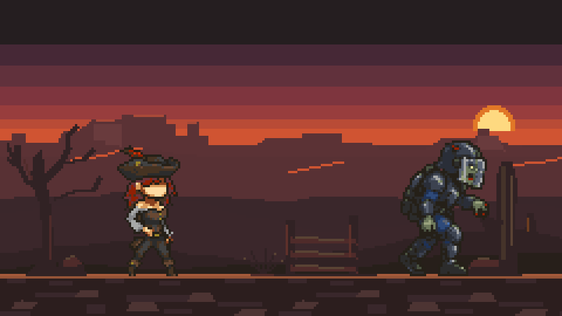
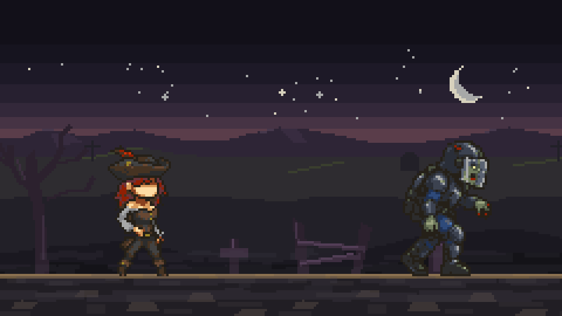
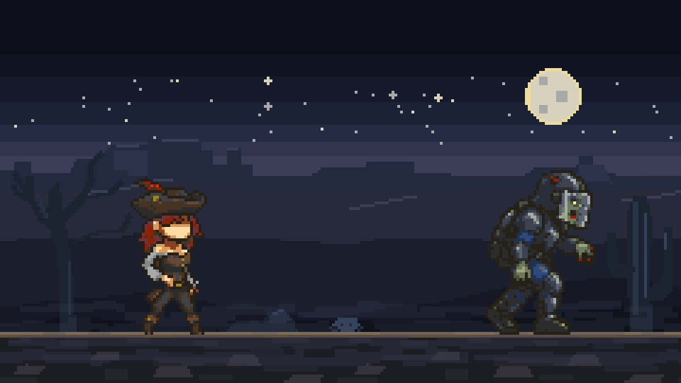
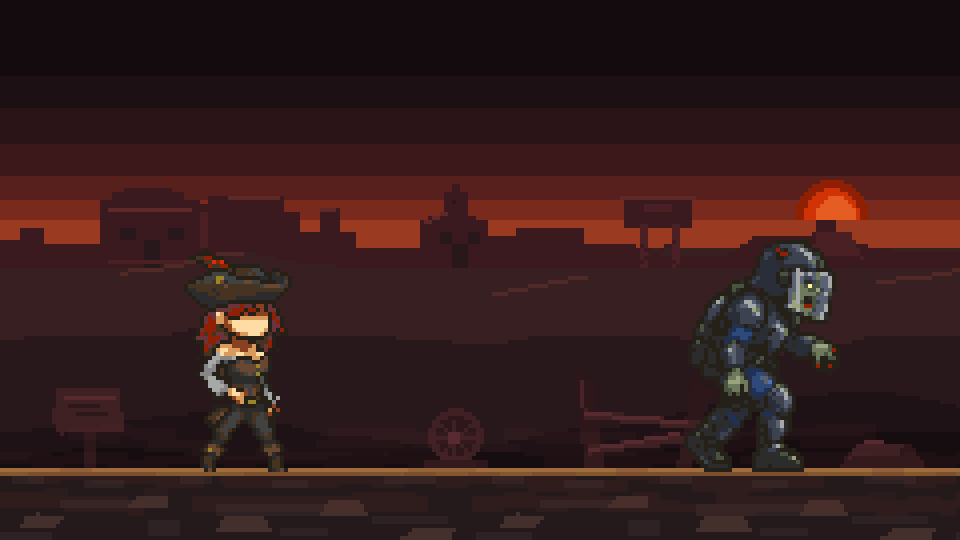
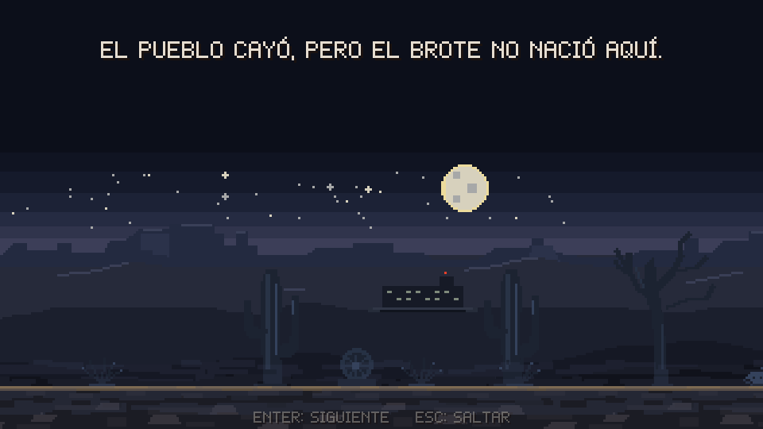

# Paisaje: fondos por capas y temas

El paisaje del juego: un viejo oeste con zombis, en capas que se mueven a distinta velocidad
(paralaje), con un **tema** por nivel. Siguen las reglas generales de
[`SPRITES.md`](SPRITES.md): PNG RGBA de 8 bits, a 1×, sin difuminado.

| Tema | Niveles | Ambiente |
| --- | --- | --- |
| `atardecer` | 1-1, 1-2 | Sol bajo, bandas de morado a naranja, mesetas encendidas |
| `cementerio` | 1-3 | Recién anochecido, morado, luna creciente, cruces a lo lejos, niebla ligera |
| `noche` | 1-4 | Luna llena, azules oscuros, niebla espesa |
| `pueblo_fantasma` | 1-5 | Cielo rojo, luna roja a medio ocultar, saloon, iglesia y tanque de agua en ruinas |
| `afueras` | 2-1 | Amanecer rosa y naranja, casas de techo de dos aguas, postes, tanque de agua, espectacular |
| `centro` | 2-2 | Tarde de esmog parda, torres con antenas y tinacos, edificios bajos, toldos y faroles |
| `vias` | 2-3 | Ocaso naranja, elevadores de grano y silos, vagones en vía muerta, catenarias; suelo de balasto con durmientes y riel |
| `ciudad_noche` | 2-4 | Noche azul, ventanas encendidas solo sobre las cabezas, escaleras de incendio, niebla, asfalto mojado |
| `base_militar` | 2-5 | Noche roja de alarma, hangares, radar y torre de control, búnkeres, torres de vigilancia y cerca; losas de concreto |

El paisaje se oscurece con la dificultad: el más rojo y opresivo es el del jefe.

|  |  |
| --- | --- |
|  |  |

`img/landscape_atardecer.png` es la idea visual original de la que salió todo el estilo.

## La regla principal: el paisaje acompaña, no compite

La vaquera y el zombi son masas oscuras con contorno casi negro y pocos acentos claros (ver
[`ZOMBIE.md`](ZOMBIE.md), *Estilo de la vaquera*). Se leen porque lo que tienen detrás del
cuerpo es **más oscuro y más plano que ellos**.

- **Bandas y masas planas:** sin degradados ni difuminado (*dithering*).
- **Siluetas sin contorno negro**, también en los decorados: solo los personajes llevan el
  contorno casi negro completo, y eso los separa del fondo.
- **Profundidad atmosférica:** cuanto más lejos, más claro y parecido al cielo, con menos
  detalle; cuanto más cerca, más oscuro.
- **Los fríos solo como tonos muy oscuros y algo cálidos** (morados y azules con rojo), nunca
  grises azulados claros.
- Sin texto, logos ni letreros legibles.

## La pantalla, medida

Todo en **píxeles del arte (1×)**; el juego escala a 4× sin suavizado, como a los personajes.

| Zona | Filas del arte | En pantalla | Qué hay |
| --- | --- | --- | --- |
| HUD | 0–25 a la izquierda, 0–20 a la derecha | 0–100 / 0–80 | Nivel, misión y ayuda; vida, XP y placa de nivel |
| Cielo libre | 21–44 | 84–176 | Luna o sol (a la derecha, desde la fila 24), estrellas |
| Zona de lectura | 45–117 | 180–470 | Placas sobre las cabezas (45–60), sombreros (≈ 60) y cuerpos |
| Mesetas y horizonte | 47–61 | 188–246 | Cimas de las mesetas y la franja más clara del cielo |
| Colinas | 61–117 | 244–470 | Lejanas con cresta iluminada; cercanas, oscuras |
| **Línea del suelo** | **117** | 468–471 | Donde pisan todos (`GROUND_ROW`) |
| Suelo | 118–134 | 472–540 | Tierra; abajo a la izquierda va el pie de pantalla |

La vaquera mide 56 px de alto y el zombi 58: sus cabezas quedan contra el cielo (silueta) y
sus cuerpos contra las colinas oscuras.

## Reglas de valor

Luminancia de 0 (negro) a 255 (blanco). `tools/check_landscape.py` las mide.

| Zona | Luminancia |
| --- | --- |
| Banda del HUD (filas 0–18) | ≤ 55, casi lisa |
| Cielo encima de las cabezas (filas 19–61) | hasta 120, en bandas planas |
| **Detrás de los cuerpos (filas 62–117)** | **≤ 62** |
| Líneas de luz de 1 px (cimas, crestas) | ≤ 120 |
| Luna o sol | hasta 220, área ≤ 400 px |
| Decorados | ≤ 75 |

## Capas

De atrás hacia adelante, en `assets/backgrounds/<tema>/`. Paralaje es la fracción del
movimiento de la cámara: 0 no se mueve, 1 va con el suelo. La tabla vive en
`src/game/themes.c` y es la misma para todos los temas.

| Archivo | Tamaño (px) | Filas | Paralaje | Se repite | Qué es |
| --- | --- | --- | --- | --- | --- |
| `sky.png` | 240 × 117 | 0–116 | 0 | No | Banda del HUD, 5 bandas, franja del horizonte, luna o sol, estrellas. Opaca |
| `far.png` | 360 × 24 | 43–66 | 0.15 | Sí | Mesetas (y fachadas en el pueblo); borde de las cimas iluminado |
| `hills_far.png` | 360 × 40 | 60–99 | 0.35 | Sí | Colinas lejanas, cresta de 1 px iluminada |
| `hills_near.png` | 360 × 38 | 80–117 | 0.6 | Sí | Colinas cercanas, oscuras |
| *(decorados)* | ver abajo | pisan en 117 | 1 | — | Repartidos por tramos (`src/game/world.c`) |
| `ground.png` | 120 × 18 | 117–134 | 1 | Sí | Línea del suelo (2 filas) y tierra. Opaca |
| `fog.png` *(opcional)* | 240 × 24 | 105–128 | 1 + deriva | Sí | Niebla semitransparente, detrás de los personajes |

- Las capas que se repiten tienen la **columna 0 igual a la última**: no se nota la costura.
- Lo que no es parte de la capa es **transparente de verdad** (alfa 0).
- La niebla es **un solo color** con alfa de 30 a 100 en 2 niveles, y se desliza sola a
  24 px/s (`FOG_DRIFT`). El atardecer no tiene.

## Decorados

Hojas en `assets/sprites/props/`, compartidas por todos los temas. Cada hoja pone sus
variantes en una fila de cuadros iguales, apoyados en su última fila. La tabla vive en
`src/game/props.c`.

| Archivo | Cuadro (px) | Variantes |
| --- | --- | --- |
| `cactus.png` | 24 × 56 | 3 |
| `rock.png` | 26 × 12 | 3 |
| `fence.png` | 44 × 26 | 2 |
| `dead_tree.png` | 48 × 70 | 2 |
| `grass.png` | 20 × 12 | 3 |
| `wagon_wheel.png` | 16 × 16 | 1 |
| `skull.png` | 12 × 7 | 1 |
| `tombstone.png` | 14 × 18 | 3 (cruz, lápida, tabla) |
| `sign.png` | 20 × 22 | 1 |

Cada tramo de 120 px pone hasta 2 decorados grandes, elegidos con los **pesos del tema**, y
1–3 matas de pasto. Están pintados con 6 colores del atardecer; los otros temas les hacen un
**cambio de paleta** al cargarse (cada color original pasa a uno del tema), así que no hay
copias por tema.

| Color original | Uso | `cementerio` | `noche` | `pueblo_fantasma` |
| --- | --- | --- | --- | --- |
| `#312224` | Cuerpo de todos | `#2c212e` | `#1c2331` | `#2d171a` |
| `#4f2b2a` | Madera y piedra | `#3d2e40` | `#263144` | `#3f2023` |
| `#45332a` | Cactus, medio | `#3a2c3d` | `#283346` | `#3b1e21` |
| `#5e302a` | Cerca, luz | `#423148` | `#2e3a50` | `#482428` |
| `#6d3d1f` | Cactus, luz | `#4c3a50` | `#34425b` | `#5c2e33` |
| `#5a4334` | Luz del lado de la luna o el sol | `#453449` | `#34425c` | `#562b30` |

| Tema | Los decorados más frecuentes |
| --- | --- |
| `atardecer` | Cactus, rocas, cercas, árbol seco |
| `cementerio` | Lápidas y cruces, árbol seco, cercas, rocas (sin cactus) |
| `noche` | Cactus, rocas, cráneos, árbol seco |
| `pueblo_fantasma` | Letreros, ruedas de carreta, cercas |

## Paletas de los temas

| Parte | `atardecer` | `cementerio` | `noche` | `pueblo_fantasma` |
| --- | --- | --- | --- | --- |
| Banda del HUD | `#251e20` | `#121019` | `#0c0f1a` | `#140b0e` |
| Cielo, arriba → horizonte | `#462836` `#61313c` `#7e353e` `#983d3d` `#b94b36` | `#16141f` `#1d1927` `#272030` `#33283a` `#463344` | `#101422` `#151a2b` `#1c2236` `#252b42` `#30344c` | `#1c1014` `#2a1418` `#3d181a` `#58201c` `#7a2a1c` |
| Franja del horizonte | `#d05432` | `#5a3d4a` | `#3c3e58` | `#9a3a20` |
| Sol o luna | `#e17727` `#fed980` | `#a7a8a8` `#d7d1bd` | `#d7d1bd` `#a7a8a8` `#ecdb9c` | `#902004` `#d03305` `#e55d22` |
| Mesetas, cuerpo y borde | `#5b3235` `#693b3d` / `#aa4a38` | `#2e2536` `#382c40` / `#46384c` | `#232a40` `#2b324a` / `#3a4058` | `#3a1a1e` `#4a2024` / `#5e2a28` |
| Colinas lejanas, cresta | `#583134` `#3a272b` / `#cd5431` | `#2e2c30` `#222028` / `#3a3f2e` | `#262a3a` `#1b1f2d` / `#3a3f56` | `#371f22` `#28171b` / `#4f2a26` |
| Colinas cercanas | `#3b272b` `#312224` `#271f1a` | `#222028` `#1a1820` `#141318` | `#1b1f2d` `#151824` `#10121b` | `#28171b` `#1e1216` `#160d10` |
| Línea del suelo | `#a45a3a` `#955437` | `#8a7050` `#6e5a40` | `#7d6a52` `#5e5040` | `#a06c3c` `#83582f` |
| Tierra y piedras | `#2c1e1e` `#39272b` / `#4d3433` | `#211e24` `#2b272c` / `#3b3434` | `#1b1c24` `#24242c` / `#34323a` | `#241a1c` `#2e2224` / `#43302c` |
| Niebla | — | `#4a4652` | `#3e4560` | `#5a2a28` |

## Agregar un tema

1. Dibuja sus capas con los tamaños de la tabla *Capas* en `assets/backgrounds/<tema>/`,
   siguiendo la estructura de las paletas de arriba (banda del HUD, 5 bandas, franja del
   horizonte, mesetas, dos capas de colinas, suelo y, si quieres, niebla).
2. Revísalas:

   ```bash
   python3 tools/check_landscape.py assets/backgrounds/<tema>
   ```

   Mide formato, tamaño, transparencias, costuras, la niebla y los valores por zona.
   `FALLO` hay que corregirlo; `AVISO` conviene mirarlo.
3. Agrega su `ThemeDef` en `src/game/themes.c` (carpeta, niebla, pesos de los decorados y
   cambio de paleta) y asígnalo a sus niveles en `src/game/stages.c`.
4. `./build.sh`: `--verify` falla si a un tema en uso le falta una capa o tiene otro tamaño.
5. Mira el nivel con los personajes delante: deben leerse por su silueta y sus acentos
   claros. Si se pierden, oscurece las colinas antes que aclarar a los personajes.

## La ruta 2: la ciudad

Los cinco temas de la ciudad salen de `tools/make_city.py` (sus paletas están en la tabla
`THEMES` del script) y pasan `tools/check_landscape.py`. Son `city` en `src/game/themes.c`:
en lugar de pasto llevan basura en el suelo (`litter`), gorriones en lugar de cuervos, banca de
hierro y bidón ardiendo en los descansos, y listas propias de casas del fondo, barricadas y
frentes de muro (`houses`, `barricades`, `walls`).

Están **a escala de la sheriff** (56 px = 1.70 m): un hidrante le llega a la rodilla, un bote
de basura a la cintura, postes y semáforos pasan muy por encima de su cabeza.

| Decorado de ciudad | Cuadro (px) | Variantes |
| --- | --- | --- |
| `hydrant.png` | 14 × 24 | 1 |
| `streetlight.png` | 40 × 150 | 2 (entero, con el brazo colgando) |
| `traffic_light.png` | 60 × 140 | 2 (derecho, descolgado) |
| `pole.png` | 44 × 160 | 1 (poste de luz con transformador) |
| `fallen_pole.png` | 150 × 26 | 1 (poste caído con sus cables) |
| `trash.png` | 26 × 32 | 2 (bote, bolsas) |
| `cone.png` | 16 × 24 | 1 |
| `tires.png` | 40 × 34 | 1 |
| `sandbags.png` | 66 × 28 | 1 |
| `jersey.png` | 104 × 27 | 1 |
| `signal.png` | 24 × 110 | 1 |
| `drums.png` | 48 × 34 | 1 |
| `litter.png` | 20 × 6 | 3 (en lugar del pasto) |

Los autos no son decorados: a su tamaño real van como piezas del camino (`sprites/terrain`):
los de paso (`vehicles.png`: tres sedanes, un todoterreno militar, un camión del ejército; se
atraviesan), los que son barricada (`car_wreck.png`: sedán, pickup y guayín; explotan), la
patrulla con sirena y el camión de provisiones. Los frentes de la ciudad (`city_fronts.png`,
240 × 192) son de dos plantas a escala: un piso mide 100 px, las ventanas son del tamaño de
una persona. Llevan los grafitis de los Buitres.

Se pintan con los mismos seis colores del atardecer y cada tema los recolorea:

| Color original | `afueras` | `centro` | `vias` | `ciudad_noche` | `base_militar` |
| --- | --- | --- | --- | --- | --- |
| `#312224` | `#2a1c24` | `#262020` | `#2a1a1c` | `#161624` | `#22100f` |
| `#4f2b2a` | `#3e2632` | `#3a2e2a` | `#40221e` | `#22223a` | `#361818` |
| `#45332a` | `#382430` | `#342a28` | `#3a201e` | `#1e1e32` | `#301616` |
| `#5e302a` | `#4a2a38` | `#463630` | `#4e2a24` | `#2a2a44` | `#421c1c` |
| `#6d3d1f` | `#5a3040` | `#54402e` | `#60321e` | `#34344e` | `#542420` |
| `#5a4334` | `#5a3a44` | `#524034` | `#5a3626` | `#343452` | `#4e2622` |

Un decorado nuevo: su hoja en `assets/sprites/props/`, una fila en `src/game/props.c` y su
peso en los temas que lo usen. Si usa colores nuevos, agrégalos al cambio de paleta de cada
tema.

En la cinta **Laboratorio 4**, el edificio se asienta en el valle: base en la fila 84
del arte, sobre una plataforma baja con sombra de contacto. Se dibuja después de
las colinas lejanas y antes de las cercanas, con paralaje 0.45, para mantener su
separación respecto a las montañas durante el paneo (`app/story_render.c`). Las
capturas `0s_laboratorio_valle_0/1` revisan ambos extremos visibles de la toma.


