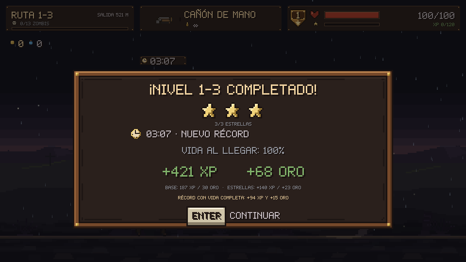
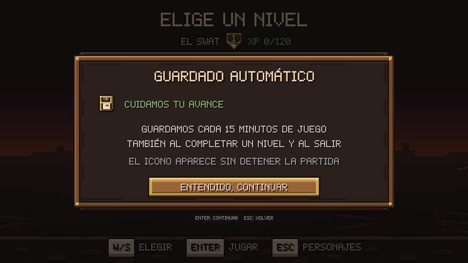

# Progreso, misiones y autoguardado

Cada personaje conserva nivel, XP, oro, niveles completados, mejores estrellas,
récords, almanaque, agua y dinamita. Subir de nivel rellena la vida hasta el nuevo
máximo sin quitar sangrado o quemaduras. Los consumibles sobrantes pasan al
siguiente nivel del mismo personaje. Reintentar o abandonar desde la pausa
restaura XP, oro y consumibles de entrada, evitando acumular botín de intentos
incompletos. Los descubrimientos del almanaque sí se conservan.

## Tiempo y estrellas

El reloj cuenta simulación activa de la misión hasta completar el cofre de salida.
No avanza en pausa, almanaque, menús o después del resultado. Su valor se guarda
con la misión. Al pasar el cursor por el reloj se ven las tres metas del nivel.
Se obtiene la mayor puntuación que cumpla **ambos** límites, tiempo y salud:

| Nivel | 3 estrellas: tiempo / salud mínima | 2 estrellas | 1 estrella | Base XP / oro |
| --- | --- | --- | --- | --- |
| 1-1 | 3:30 / 90 % | 4:45 / 60 % | 6:15 / 20 % | 30 / 25 |
| 1-2 | 3:45 / 90 % | 5:15 / 60 % | 6:45 / 20 % | 93 / 28 |
| 1-3 | 4:15 / 85 % | 5:45 / 55 % | 7:30 / 20 % | 187 / 30 |
| 1-4 | 4:30 / 85 % | 6:15 / 55 % | 8:00 / 15 % | 324 / 34 |
| 1-5 | 6:00 / 80 % | 8:15 / 50 % | 10:30 / 15 % | 503 / 38 |

Los límites son inclusivos. Superar ambos requisitos de tres estrellas nunca
concede más de tres. Terminar fuera de las metas da cero estrellas y conserva
la recompensa base y el desbloqueo del siguiente nivel.

Las metas se calculan en `src/game/mission.c` a partir de la longitud del camino
a velocidad de caminar, disparos estimados contra la vida y armadura de cada
enemigo, cadencia del cañón, reacción y obstáculos. Tienen un margen del 15 % y
se redondean a intervalos de 15 segundos. Los límites de dos y una estrellas
son 1.35 y 1.75 veces el de tres, redondeados. La complejidad amplía la tolerancia
de salud. Son una calibración inicial por las reglas actuales; el ajuste fino
requiere partidas de prueba con jugadores.

## Recompensas

La base depende de la dificultad del nivel y es independiente del nivel actual
del personaje:

- XP: `redondear(XP para subir desde el nivel de zombis × 0.25 × complejidad)`.
- Oro: `redondear(25 × complejidad)`.
- Estrellas: `redondear(base × 0.25 × estrellas)` adicional para cada moneda.
- Récord y vida completa: `redondear(base × 0.50)` adicional, solo si el tiempo
  mejora estrictamente el récord personal y la vida al terminar es del 100 %.

La primera victoria establece un récord. Igualarlo no da el bono. Mejorarlo
con menos del 100 % actualiza el récord, sin ese extra. Se guardan por separado
la mayor cantidad de estrellas y el mejor tiempo, aunque provengan de partidas
distintas. La salud del resultado se fija antes de aplicar una posible curación
por subir de nivel con el bono final.

El cofre de salida paga la base una sola vez. Al finalizar se añaden los bonos;
la ventana presenta el total y el desglose. No incluye en ese total los enemigos,
cofres y cajas cobrados previamente durante el recorrido. Por ejemplo, 1-3 con
tres estrellas y récord al 100 % concede `187 + 140 + 94 = 421 XP` y
`30 + 23 + 15 = 68 oro` por la misión.

## Autoguardado

Antes de entrar a la primera misión de cada sesión aparece un aviso. Después
se guarda sin interrumpir la partida:

- Cada 900 segundos de juego activo; pausas, almanaque y menús no cuentan.
- Al entrar, subir de nivel, completar o abandonar una misión.
- Al cerrar la ventana o salir desde el menú.

Cada solicitud aceptada reinicia el contador de 900 segundos. La instantánea se
prepara en memoria y un hilo SDL escribe los archivos. El pequeño disquete del
HUD indica guardando, guardado o error; no captura controles. Si falla una
escritura periódica, se reintenta tras 30 segundos. Al cerrar se espera la última
escritura pendiente antes de liberar SDL.

Hay una misión pendiente por partida guardada. Al volver a abrir, se elige el
mismo personaje y nivel: el menú lo selecciona y muestra que se puede continuar.
Se restaura posición, vida, condiciones, equipo y munición, inventario, reloj,
enemigos, cofres, trampas, proyectiles y dinamita en curso. El paisaje y los
efectos decorativos se regeneran. Entrar a otro nivel reemplaza la misión
pendiente y restaura sus saldos de entrada como un abandono; los demás perfiles
y sus progresos se conservan.

Los archivos viven en el directorio de datos de usuario que devuelve
`SDL_GetPrefPath("TheMiracle", "TheMiracle")`, junto a las preferencias. No se
escriben dentro del ejecutable ni de `assets/`:

- `avance_a.sav` y `avance_b.sav`: generaciones alternas.
- `avance_a.sav.tmp` o `avance_b.sav.tmp`: escritura pendiente, ignorada al cargar.

Cada archivo lleva cabecera, generación, tamaño y CRC32. Al cargar se elige la
copia más reciente cuyo contenido y esquema sean válidos; si falla se intenta
la anterior. Una escritura fallida conserva la copia activa. El esquema actual
es 8; se aceptan los anteriores. El 3 agregó el volumen de la música y el 4 el
Expediente (pistas encontradas, casos resueltos y escenas de fin de nivel vistas,
compartido por todos los personajes); una partida vieja lo empieza vacío. El 5 amplió
la segunda ruta y sus enemigos. El 6 convierte el antiguo cañón de mano en un
revólver de ocho balas, con un tambor lleno al migrar una partida anterior; las
partidas nuevas conservan exactamente la munición y las recargas en curso. El 7 agrega
el tambor independiente del segundo revólver, incluso guardado con Q, el arma que
se está recargando y la recarga secuencial pendiente. Al migrar duales antes infinitas,
el revólver principal recupera su cuenta guardada y el segundo empieza lleno. Desde el
8 también se conserva el cambio de mano de una recarga doble (`reload_pair`),
incluido el segundo tambor. Desde el 1 se inicializan las estrellas, récords e inventario sin inventar puntuaciones
históricas. La codificación usa campos explícitos
little endian, sin direcciones de memoria ni estructuras nativas.

Las pruebas usan carpetas temporales aisladas, incluyendo nombres con acentos,
y procesos distintos para guardar y cargar. Humo y capturas desactivan el
guardado, por lo que no modifican el avance real del jugador. El diseño contempla
Windows y Linux; la validación nativa en Windows queda pendiente.
